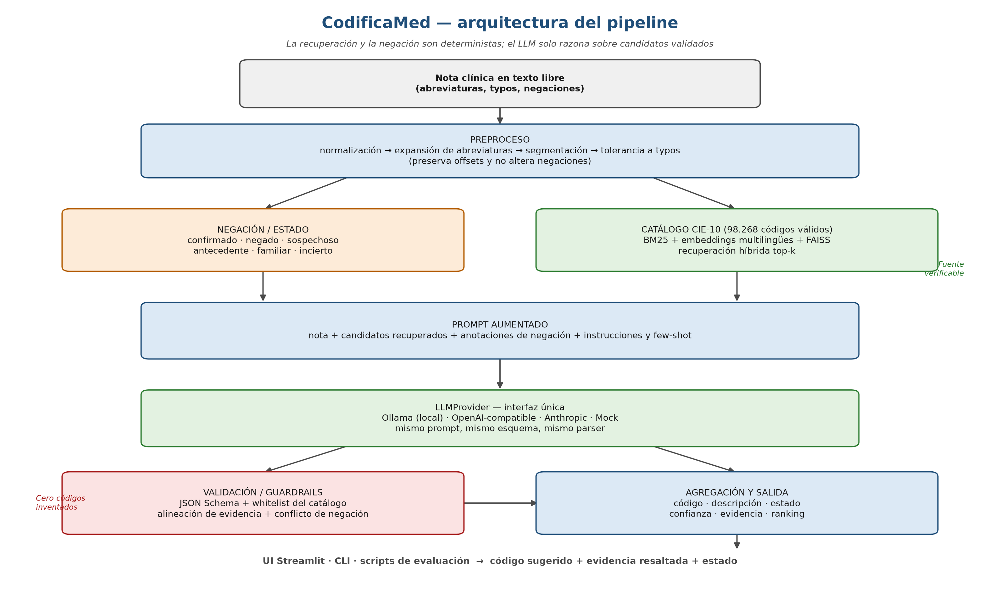

# Arquitectura — CodificaMed



## 1. Vista general

CodificaMed es un pipeline de PLN con recuperación aumentada por generación (RAG) y guardrails deterministas. La nota clínica entra como texto libre; el sistema recupera candidatos del catálogo CIE-10, detecta negaciones y estados, pide al LLM que seleccione y justifique códigos, y valida la salida contra el catálogo y el texto original.

```text
Nota → preproceso → negación/estado → recuperación híbrida → prompt → LLM
     → validación → agregación → API FastAPI → frontend web / Streamlit / CLI
```

## 2. Componentes

| Componente | Responsabilidad | Implementación |
|---|---|---|
| Configuración | Leer `.env`, validar tipos, resolver rutas | `src/config.py` |
| Modelos de dominio | Catálogo, candidatos, evidencia, predicción | `src/catalog/models.py` |
| Preproceso | Normalizar, expandir abreviaturas, segmentar, tolerar typos | `src/preprocess/` |
| Catálogo | Cargar y validar los 98.268 códigos válidos | `src/catalog/loader.py` |
| Recuperación | Embeddings E5, FAISS, BM25, fusión RRF y evaluación recall@k | `src/retrieval/hybrid.py`, `scripts/build_index.py`, `scripts/evaluate_retrieval.py` |
| Negación | Disparadores y estado por cláusula con reglas españolas | `src/negation/detector.py` |
| NER | Entidades clínicas opcionales | `src/ner/` |
| LLM | Interfaz única y adaptadores HTTP Ollama/OpenAI-compatible/Anthropic/Mock | `src/llm/base.py`, `src/llm/providers.py` |
| Pipeline | Orquestación, evidencia literal, validación de catálogo y estado | `src/pipeline/engine.py` |
| Evaluación | Métricas, datasets, reportes | `src/eval/` |
| API | FastAPI, endpoints, serialización y orchestración | `backend/main.py`, `backend/services/` |
| Frontend web | HTML/CSS/JS estático con interacción directa a la API | `web/index.html`, `web/static/` |
| Interfaz legacy | Streamlit para demos rápidas | `app/streamlit_app.py` |

## 3. Flujo de datos

1. **Entrada:** nota clínica, `note_id` y configuración del proveedor.
2. **Normalización:** se preserva el texto original y se construye un mapa de offsets.
3. **Abreviaturas:** se expanden términos como `HTA`, `DM2`, `dolor abd` sin perder la mención original.
4. **Segmentación:** oraciones con offsets para asociar evidencia y negación.
5. **Negación:** reglas en español clasifican cláusulas; los alcances cambian en conjunciones adversativas como «pero».
6. **Recuperación:** BM25 y FAISS devuelven candidatos; RRF fusiona y corta a top-k.
7. **Prompt:** se envía la nota, los candidatos y las anotaciones de estado por cláusula.
8. **LLM:** devuelve JSON con códigos, estado, evidencia, confianza y justificación.
9. **Validación:** se rechaza todo código que no esté en el catálogo o en los candidatos y toda evidencia no literal; las reglas de estado prevalecen cuando marcan una negación, sospecha o antecedente.
10. **Salida:** `Prediction` con códigos, candidatos, latencia, uso y warnings.

## 4. Interfaz `LLMProvider`

```python
class LLMProvider(ABC):
    @abstractmethod
    def complete(
        self,
        messages: list[Message],
        *,
        temperature: float = 0.0,
        max_tokens: int = 1200,
        response_format: str | None = "json",
    ) -> LLMResponse: ...
```

- `OllamaProvider`: HTTP a `/api/chat`.
- `OpenAICompatibleProvider`: HTTP con endpoint `/chat/completions` y `base_url` configurable.
- `AnthropicProvider`: HTTP al endpoint Messages de Anthropic.
- `MockProvider`: respuestas deterministas para tests y demo sin red.
- `create_provider`: elige el proveedor por `LLM_PROVIDER`; valida la clave requerida.

Ningún proveedor construye prompts ni parsea la salida por su cuenta: eso vive en `prompts.py` y `schemas.py`.

## 5. Guardrails

| Riesgo | Guardrail |
|---|---|
| Código inventado | Whitelist estricta contra los 98.268 códigos válidos |
| Evidencia falsa | Búsqueda exacta y fuzzy en el texto original |
| Negación ignorada | La regla determinista tiene prioridad sobre el LLM |
| JSON inválido | Validación Pydantic + un reintento de reparación |
| Prompt injection | Instrucciones del sistema y candidatos acotados |
| Fuga de claves | `SecretStr`, logs sin secretos, `.env` ignorado |
| Costo excesivo | Límite de tokens, top-k y cache |

## 6. Despliegue

- **Local:** `uv` + Python 3.11, Ollama y FastAPI.
- **Frontend web:** HTML/CSS/JS servido por FastAPI en `web/`.
- **API:** endpoints REST de FastAPI que consumen la lógica central en `src/`.
- **Legacy UI:** Streamlit para demostraciones rápidas y validación local.
- **Datos:** CodiEsp descargado por script; índice FAISS construido localmente.
- **Reproducibilidad:** versiones fijadas, semillas, cache de respuestas y manifiesto de datos.

## 7. Decisiones de arquitectura

| ID | Decisión | Alternativa | Motivo |
|---|---|---|---|
| A-001 | RAG sobre catálogo | LLM zero-shot | Evita alucinación y fundamenta el código |
| A-002 | Híbrido BM25 + denso | Solo denso | BM25 captura abreviaturas y términos exactos |
| A-003 | Negación por reglas | Solo LLM | Explicable, determinista y auditable |
| A-004 | FAISS | ChromaDB | Exacto y rápido a 98k; menos dependencias |
| A-005 | `LLMProvider` | Código por proveedor | Requisito 4 y testeabilidad |
| A-006 | Streamlit | React/FastAPI | Rapidez y resaltado en Python |
| A-007 | Validación estricta | Confiar en el LLM | Seguridad y trazabilidad |

## 8. Diagrama de despliegue

```text
┌──────────────────────┐        ┌──────────────────────────────┐
│ Navegador            │  HTTP  │ FastAPI backend               │
│ HTML/CSS/JS         │◄──────►│ backend/main.py               │
└──────────────────────┘        └────────────┬─────────────────┘
                                             │
                         ┌───────────────┼────────────────────┐
                         ▼               ▼                    ▼
             ┌──────────────────┐  ┌──────────────────┐  ┌──────────────────┐
             │ Core PLN / RAG   │  │ Ollama local     │  │ Legacy Streamlit │
             │ src/             │  │ /api/chat        │  │ app/streamlit    │
             └──────────────────┘  └──────────────────┘  └──────────────────┘
```
